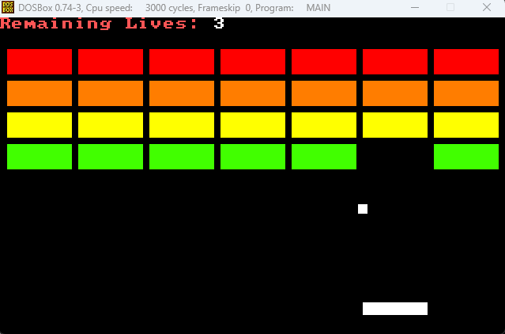
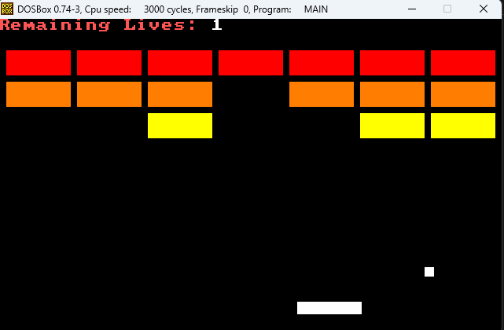
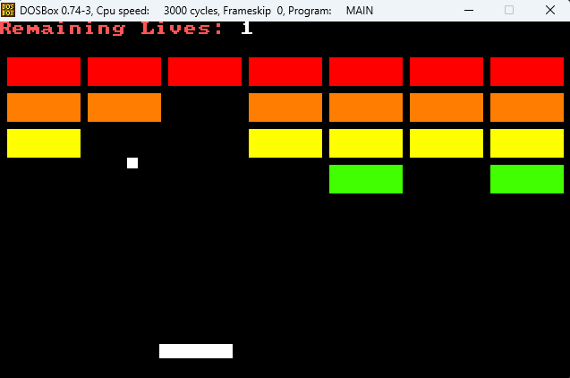
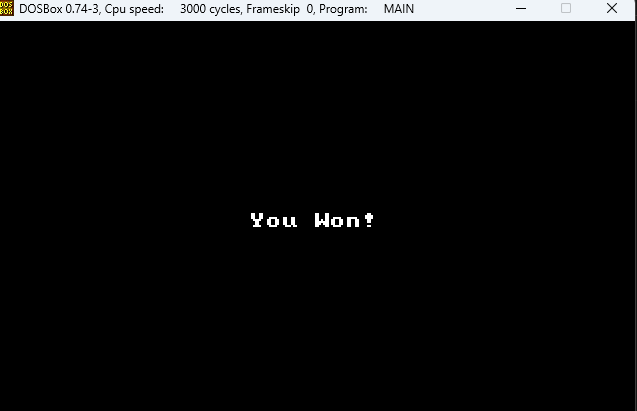
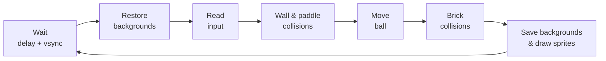

<div align="center">

# 🧱 Brick Breaker - x86 Assembly

**A complete brick-breaking arcade game written from scratch in 16-bit x86 Assembly.**
No engine, no libraries: just registers, BIOS interrupts and raw video memory.




</div>

---

## 🎮 About

Brick Breaker is a classic arcade game. Keep the ball in play with your paddle and break every brick on the board.
The whole game (rendering, physics, collision detection, input, HUD and game states) lives in a single
assembly file and runs on real-mode DOS. Every pixel on screen is placed by hand-written code.

## ✨ Features

- 🧱 **28 breakable bricks**: a 7 × 4 grid with a color for each row: red, orange, yellow and green
- 🏓 **Responsive paddle** with screen-edge limits
- ⚪ **Bouncing ball physics**: it bounces off the walls, the ceiling, the paddle and the bricks
- 💥 **Accurate collision detection**: rectangle-overlap (AABB) checks for every brick
- ❤️ **Lives system**: 3 lives, shown live in the top-left corner
- 🎲 **Random start direction** seeded from the BIOS system clock
- 🖥️ **Flicker-free rendering** using background buffers and VGA vertical-sync timing
- 🏆 **Win screen** once the last brick falls

## 📸 Screenshots

<table>
  <tr>
    <td align="center"><br><b>Full board</b></td>
    <td align="center"><br><b>Clearing the rows</b></td>
  </tr>
  <tr>
    <td align="center"><br><b>Down to the last life</b></td>
    <td align="center"><br><b>Victory!</b></td>
  </tr>
</table>

## 🕹️ Controls

| Key   | Action             |
|:-----:|--------------------|
| `A`   | Move paddle left   |
| `D`   | Move paddle right  |
| `Esc` | Quit the game      |

## ⚙️ How It Works

### The game loop

Each frame runs through the same fixed pipeline:



### 🖥️ Flicker-free graphics

Erasing a sprite by painting it black would also wipe out whatever was behind it.
So before the paddle and ball are drawn, the game **copies the pixels underneath them** into a buffer
straight from video memory at `A000h`. On the next frame it **restores** those pixels and then draws the
sprites in their new positions. The loop also waits for the **VGA vertical retrace** (port `3DAh`),
so the screen is never updated in the middle of a refresh.

### 💥 Collision detection

The ball and every brick are treated as rectangles. A hit happens only when all four conditions are true:

```
ball.right  > brick.left
ball.left   < brick.right
ball.bottom > brick.top
ball.top    < brick.bottom
```

When one check fails, the code skips to the next brick right away. A hit brick is marked as destroyed in a
`blocks_alive` table, painted out and taken out of play, and the ball flips its vertical direction.

### 🧱 Brick grid

The bricks are drawn with **two nested loops** over a table of X positions and a table of Y positions.
The item counts are worked out by the assembler itself (`($ - array) / 2`), so the layout can be changed
by editing a single line.

### 🎲 Randomness

The ball's starting direction comes from the BIOS tick counter (`INT 1Ah`), so every game opens differently.

## 🔧 Under the Hood

| Interrupt / Port | Used for |
|------------------|----------|
| `INT 10h`        | Video mode 13h, pixel plotting, cursor position, text output |
| `INT 16h`        | Non-blocking keyboard input |
| `INT 15h`        | Frame timing delay |
| `INT 1Ah`        | System clock → random seed |
| `INT 21h`        | Program exit |
| Port `3DAh`      | VGA vertical-retrace sync |
| Segment `A000h`  | Direct video memory access |

### Code structure

| Procedure | Role |
|-----------|------|
| `DrawBlocks` / `DrawBlock` | Draws the brick grid with nested loops |
| `DrawPaddle` / `DrawBall` | Sprite rendering |
| `SaveArea` / `RestoreArea` | Copy background pixels to and from memory |
| `CheckPaddleMovement` | Keyboard → paddle movement |
| `MoveBall` | Moves the ball by its direction flags |
| `CheckBlockCollision` | Brick hits and removal |
| `BallCollisionPaddle` | Paddle bounce |
| `BallCollision*Boundaries` | Wall bounces, losing a life |
| `DisplayLives` / `DisplayNumber` | HUD text |
| `DisplayWin` | Victory screen |

## 🚀 Running the Game

The game needs a DOS environment such as [DOSBox](https://www.dosbox.com/) and Turbo Assembler.

```bat
tasm /zi main.asm
tlink /v main.obj
main.exe
```

---

<div align="center">

Made with ☕ and a lot of `int 10h`

</div>
